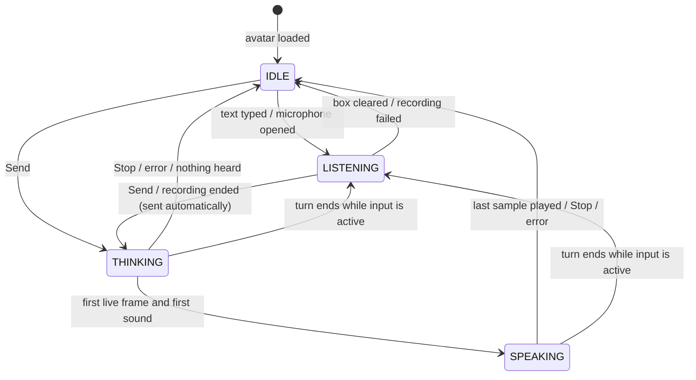

# Avatar Studio

A local, self-hosted **streaming conversational photo-avatar prototype**:

**HD portrait → microphone/text → STT → LLM → TTS → full-face animation → browser video**

Includes a browser workspace, reusable avatar URLs, persisted conversations, consent confirmation, and OpenAI-compatible endpoint integration. Live text replies stream synchronized PCM audio and generated JPEG frames over a same-origin WebSocket before the archival MP4 finishes. Recorded microphone turns retain the original HTTP workflow; this is not full-duplex voice or WebRTC.

For a full-length photo that must stay uncropped at its own resolution, see [PhotoStage](#photostage-independent-full-photo-preview-port-8001), a separate application on port 8001 that animates the head in place, moves the body, and gives the hands expressive gestures, with a console to manage many avatars and a player page that shows one.

## Stack

| Component | Local default | Alternative |
|---|---|---|
| Web/API | Vanilla HTML/CSS/JavaScript + FastAPI | Same-origin, no frontend build needed |
| STT | faster-whisper tiny.en, CPU | OpenAI-compatible `/audio/transcriptions` |
| LLM | Qwen2.5-0.5B-Instruct, warm GPU in live mode; CPU in batch mode | OpenAI-compatible `/chat/completions` |
| TTS | Piper, en_US-lessac-medium, CPU | OpenAI-compatible `/audio/speech`, WAV |
| Avatar animation | FlashHead Lite: streaming head/face motion | LiveTalk: full-frame body animation; FlashHead Pro: batch; MuseTalk: legacy mouth-only |
| Storage | SQLite and local generated media | Single-process local development |

The small English-language models are practical defaults for local verification, not a claim of enterprise-level conversational quality. Use a stronger LLM and appropriate multilingual speech models/endpoints for production.

## Install

Python 3.10+ and Git are required. For inference, install a compatible CUDA-enabled PyTorch/torchvision pair first, following [PyTorch's installation instructions](https://pytorch.org/get-started/locally/).

```bash
python3 -m venv .venv
source .venv/bin/activate
python -m pip install -r requirements-models.txt
# Install the CUDA PyTorch + torchvision pair appropriate for your driver.
cp .env.example .env
python scripts/setup_models.py
# Keep the full-face renderer's dependencies separate from STT/TTS/LLM.
python3 -m venv .venv-flashhead
# Install a compatible CUDA PyTorch + torchvision pair into this environment too.
.venv-flashhead/bin/python -m pip install -r requirements-flashhead.txt
python scripts/setup_flashhead.py --model-type lite
python run.py
```

Open **http://localhost:8000** on the machine running the application. In remote VS Code, forward port 8000 and open the forwarded localhost URL.

This workspace was validated using workspace-local virtual environments with `--system-site-packages` to reuse the machine's existing CUDA PyTorch/torchvision without modifying shared packages. The app and full-face renderer have intentionally separate Diffusers/Transformers dependencies; the MediaPipe renderer also needs older Protobuf. Do not run unrelated services such as vLLM or Riva from either environment. For a fresh installation, prefer the fully isolated environments above. Tested inference used PyTorch 2.9.0+cu128 and torchvision 0.24.0+cu128.

Downloads take several GB. Setup pins the MuseTalk and FlashHead source revisions and never starts or stops existing services. FFmpeg is supplied by `imageio-ffmpeg`; no system-wide FFmpeg install is required. All downloads are dependencies, not application source.

### Full-face motion versus mouth-only animation

With **`AVATAR_RENDERER=flashhead`** and **`LIVE_STREAMING=true`**, a persistent FlashHead **Lite** worker streams 512×512 portrait motion. It caches a four-second silent idle loop using the model's subtle motion, without forced blinks or eye warping. The loop stays visible while waiting for live speech and returns when playback finishes. Face detection crops the input to head and shoulders: this renderer does **not** preserve a full-length person.

Lite streams JPEG frames at quality 88 to reduce compression artifacts in the browser. Actual detail remains limited to the model's 512×512 output and the source portrait. The higher JPEG quality uses more network bandwidth; it does not change model resolution or GPU inference speed.

An avatar can use a separately rendered, silent listening clip by placing an H.264 MP4 at `data/media/<avatar-id>.lite-head-idle.mp4`. The next live session uses that clip in place of the default idle loop. Match the Lite portrait framing, and review the movement and loop before publishing the clip. This does not switch the speech renderer or generate another video during a reply.

Set `LIVE_STREAMING=false` and download `python scripts/setup_flashhead.py --model-type pro` for the older FlashHead **Pro** / Wan VAE batch renderer. Both variants synthesize facial/head motion rather than applying a mouth patch. Pro favors fidelity over latency.

The FlashHead renderers use native PyTorch attention and disable upstream compilation. No custom CUDA build or multi-GPU scheduling is needed. The isolated dependencies omit upstream's Gradio demo and optional acceleration packages.

`FLASHHEAD_PYTHON` can point to another FlashHead virtual environment; keep the path to its `bin/python` symlink rather than resolving it to the system Python. Use `RENDER_TIMEOUT=600` for full-face generation. Set `AVATAR_RENDERER=musetalk` and restart to explicitly choose the original mouth-region renderer. Unknown renderer names fail at startup, and failed FlashHead generation never silently falls back to mouth-only video. An absent `AVATAR_RENDERER` retains the original MuseTalk behavior for older installations.

Emotion and gaze are generated from the speech/model, not controlled by an explicit emotion prompt. They are not guaranteed to match every sentence's meaning. Expressive TTS can improve the overall experience, but quality and identity consistency still need review on your own portraits.

### Full-length / Holobox rendering

New uploads retain a full-resolution, uncropped, lossless PNG for photo display, separate from the normalized animation input. The display copy honors EXIF orientation, preserves transparency and compatible color profiles, and omits EXIF metadata. Existing avatars keep their current saved image; re-upload from the source if the old copy lost detail. This preserves the still image, not the resolution or appearance of generated motion.

The separate **`AVATAR_RENDERER=livetalk`** profile uses the released LiveTalk/OmniAvatar diffusion model to generate the **whole person**, including facial, hand, and body motion. It does not paste an animated face onto a still body. Upload an authorized image already showing the entire person, including feet, with room for gestures.

```bash
# Separate environment: do not replace the working FlashHead/app packages.
python3.10 -m venv .venv-livetalk
.venv-livetalk/bin/python -m pip install -r requirements-livetalk.txt
.venv/bin/python scripts/setup_livetalk.py
```

Set `AVATAR_RENDERER=livetalk`, `LIVE_STREAMING=true`, and optionally `LIVETALK_PYTHON=./.venv-livetalk/bin/python`, then restart. The supplied full-body requirements use native PyTorch attention and pin PyTorch 2.9 / torchvision 0.24, matching this machine's validated CUDA 12.8 installation. These differ from upstream's PyTorch 2.8 environment; validation here covers inference, not training. Source and checkpoint revisions are pinned. No community attention wheel or shared-system package replacement is required.

The adapter fits the **entire image**, without face cropping, into a model-resolution canvas with a 384×384 pixel budget, prioritizing live speed. Temporary padding is removed from generated frames. MP4 output is resized to the stored input image dimensions; this is upscaling, **not native HD generation**. A 480×1600 input uses 192×640 generated content and returns a 480×1600 MP4. Original scene/background composition is retained as a conditioning target, but diffusion can change background details; preservation is not pixel-identical. Hands, identity, feet, and expression quality need visual review.

**Current performance limitation:** the warm full-body native-attention benchmark generated 11.40 seconds / 183 frames in **41.37 seconds** on the available H100. From observed chunk arrival times, continuous playback of that sample would have required roughly **30 seconds** of initial buffering, before LLM, TTS, or browser overhead. The deployed configuration remains on FlashHead Lite; the experimental full-body profile is not a low-latency replacement.

Moving the attention cache's host-only counters off the GPU reduced a separate 5.70-second warm test from **20.54 to 19.38 seconds**, with identical JPEG frames for the same random seed. Cache tensors holding attention data remain on the GPU. This improvement is still well below the 16 FPS playback rate.

An offline benchmark also verified a **1080x1920** portrait export by scaling the video to fit and padding its sides. This preserves head-to-shoes framing without stretching, but it does not add native image detail or make rendering real-time. It is not the resolution of the deployed live stream.

**Avatar-Forever evaluation (offline only):** The released pipeline generated 153 frames at **480x832, 25 FPS** from an uncropped, padded source image on GPU 1. The warm run took **36.76 seconds to first decoded batch** and **45.45 seconds total** for 6.12 seconds of video, with about **70 GiB** peak GPU allocation. Sampled frames kept the head and shoes in frame, but did not show convincing body gestures. The released pipeline denoises the full turn before decoding, so this is not browser streaming or native 1080x1920 validation. The [benchmark script](scripts/benchmark_avatarforever.py) is separate from the live service and uses the pinned upstream code and local checkpoints.

Select **Holobox view**, or append `?display=holobox` to an avatar URL, to fill the browser viewport without the workspace panels. The whole image is contained, never zoomed or stretched to crop its feet/head. Use browser fullscreen for the physical display. The message composer remains available at the bottom.

### PhotoStage: independent full-photo preview (port 8001)

[PhotoStage](photostage/) is a separate application; selecting it does not change the renderer on port 8000. Upload an authorized, sharp photo of one person facing the camera and get an avatar that talks, with a link that opens in any browser. The page preserves the **whole input framing**, never cropping the head or feet. The legacy photo/head canvas is capped at 1920 px on its longest side; MuseTalk renders at no more than its video frame's actual resolution, with the same full-photo aspect ratio and CSS screen fit. Without a video pack, the background remains the original photo. Full-avatar video packs instead redraw the whole scene at the video's resolution; they do not preserve every original pixel. The rig is measured for each uploaded photo, rather than hand-tuned to one image; detection and visual quality still depend on the input. Local Qwen and Piper, optional STT, and the existing OpenAI-compatible provider settings are supported. Microphone input requires HTTPS or localhost.

**Console and player.** `/` is the console: every avatar as a card (its picture, name, size, date, and a badge saying what its body does: **Hands + sway**, **Sway** or **Head only**), a search box, **New avatar** (the photo, a name and the consent box) and, for each avatar, **Open**, **Copy link**, **Settings** and **Delete**. Settings renames the avatar, sets its options (with presets: all controls, no microphone, avatar only) and shows its link and an `<iframe>` embed code; Delete asks first and is refused while the avatar is speaking. `/a/<id>` is the player: the avatar alone, filling the page, with a chat box under it and the reply as text. What the player shows is a set of options. Each avatar is saved with its own in Settings, and the address of the page overrides them for one browser (the address wins, and a value that makes no sense is ignored): `http://<host>:8001/a/<id>?chat=0` shows the avatar alone, `?mic=0&reply=1&motion=0.5&mode=speak` changes several. An option that needs another is off while that one is off (the microphone needs the chat box).

| Option | Default | What it controls |
|---|---|---|
| `chat` | on | The text box and **Send** under the avatar. Off: the avatar alone |
| `mic` | on | The **Record** button. A recording is sent as soon as it ends, and recording while the avatar answers interrupts it (needs `chat`; browsers allow the microphone only on HTTPS or localhost) |
| `modes` | on | Lets the viewer choose between a conversation and speaking an exact text (needs `chat`) |
| `mode` | `chat` | The starting mode: `chat` answers with the language model, `speak` says what was typed (needs `chat`) |
| `stop` | on | The **Stop** button (needs `chat`) |
| `reply` | on | The reply as text below the avatar (needs `chat`) |
| `status` | on | The line with progress such as Thinking and Speaking; errors always show |
| `fullscreen` | on | The fullscreen button |
| `motion` | 1 | Breathing, sway and hand gestures: 0 turns them off, 1 is the normal strength, 2 the liveliest |
| `clips` | on | Recorded gestures and thinking clips, for an avatar that has a clip pack (needs `motion`; see [body clips](#body-clips-recorded-gestures-under-the-live-head)). Off: the built-in body motion |
| `home` | off | A small link back to the console; leave it off on screens that others use |

To embed an avatar, Settings gives `<iframe src="http://<host>:8001/a/<id>" width="480" height="800" allow="microphone; fullscreen" style="border:0"></iframe>`: the options saved for the avatar apply inside it, and `?…` can be added to its `src` as above.

The same things are available over HTTP (the console uses them; FastAPI's interactive documentation is at `/docs`):

- `GET /api/options`: the options with their kinds, defaults, ranges and texts, so that no client has to copy them.
- `GET /api/avatars`: every finished avatar, newest first (`key`, `name`, `created`, `size`, `url`, `thumb`, `motion`, `options`). `GET /api/avatars/<id>` is one of them.
- `PATCH /api/avatars/<id>` with JSON `{"name": "...", "options": {"chat": false}}` renames and/or changes options (the others keep theirs; a value that equals the default is not stored, so a default changed later reaches the avatars that never chose). Anything invalid is refused with 422 and nothing is changed.
- `DELETE /api/avatars/<id>`: 204, or 409 while the avatar is speaking.
- `POST /avatars`: multipart `image`, `consent=true` and an optional `name` (the file's name is used without one); answers `{"url": "/a/<id>", "key": "<id>"}`.
- `WS /turn/<id>`, `POST /transcribe` and `GET /status` are what the player uses.

Making, renaming and deleting avatars must come from a page of the same server (another site's request is refused with 403). Set **`PHOTOSTAGE_ADMIN_TOKEN`** (ASCII) to ask for a token as well: listing, making, renaming and deleting then need it as `x-admin-token`, the console asks for it once per tab, and the player, its pictures and the viewer's own requests never need it. Without it there is no authentication at all (see the caveat below).

**MuseTalk lip-sync inside the gesture videos (`PHOTOSTAGE_RENDERER=musetalk`).** This profile replaces FlashHead facial reenactment with video-native dubbing, not a separately pasted head. MuseTalk 1.5 regenerates the lower face inside each full-avatar gesture frame (`mode: avatar`), using a feathered face-parsing mask and optical-flow detail restoration. The head pose, outline, neck, body and background stay in the same frame, removing the independent head/body registration that caused drift. Lip-sync is generated at 256 px and resized into the source face; detail restoration does not create genuine higher-resolution facial features. Blinks, upper-face expressions and head motion come from the gesture videos.

For conventional multi-clip packs, the server plans gestures and rests from the reply's text and duration ([photostage/dubplan.py](photostage/dubplan.py)), then crossfades between clips. Each rest's starting frame is chosen to reduce pose differences at both ends. Lip-sync fades out over 0.2 s after the last sound. If a gesture is still playing then, it holds until just before that gesture returns to the photo's pose, with silence supplied to MuseTalk. A generated gesture's own mouth can keep moving after its speech. This reduces transition ghosting but cannot guarantee invisible joins between different poses; generated assets and transitions still need visual review. The browser plays idle, listening and thinking clips locally, then displays the completed dubbed frames during speech. Without a full-avatar pack (or with clips disabled), it dubs the still photo. Old FlashHead idle/head layers are not shown in this profile. The installed minimal continuous pack instead uses the phase-matched handoff described below.

The first preparation builds `dub-<clip>.npz` caches beside the clips (face boxes, latents and masks). When materials are rebuilt, a disk cache is reused only if its source-file size, modification time and frame geometry match. Restart after replacing clip files without rebuilding their manifest so that in-memory materials are refreshed too. The earlier five-clip Wan pack took about 47 s to prepare initially and about 2 s to load from cache; the previous eight-clip Live Avatar pack's preparation is described below. Measured warm GPU0 inference used about 8 ms GPU and 3 ms CPU per picture. These are renderer measurements, not end-to-end response times: TTS and Whisper process the reply before its first frame, chat adds the LLM wait, and transport/decoding add further delay. Playback retains the adaptive 1.3-second startup buffer; fast inference alone is not enough to start safely on a slow connection. The thinking animation covers this wait.

The previous Live Avatar pack streamed 25 fps JPEG at 786 x 1408, with a recorded **3.6-3.8 MB per second of video including base64**. Its source body clips run at 25 fps; the appended Wan bridges have the motion-speed limitation described below. The earlier Wan pack streamed 704 x 1264 at about 3.4 MB/s with 16 fps body motion. Neither is a 30/60 fps motion or sub-second audible-response guarantee. Use a fast LAN; bandwidth and browser performance can cause buffering. This differs from the removed static-photo MuseTalk mouth-overlay design: the face is dubbed in each moving gesture frame before delivery.

Earlier browser checks (1072 x 1920 canvas, before the rendering optimization below) after restoring adaptive buffering started short replies in 1.46-2.25 s, one longer reply in 4.65 s, and one local-LLM conversation in 2.69 s, with no audio underruns. Stop followed by another reply also passed. These are individual observations, not latency guarantees. An earlier shared-browser run dropped the listening clip; the isolated three-turn reuse check had no dropped/broken clips, but client-side stalls remain subject to the existing quiet-clip fallback.

**Minimal idle and smoother lip-sync playback (earlier Wan pack).** Idle generation requests a steady gentle smile, a tiny lower-hand/finger adjustment, and brief blinks, without nodding, swaying or visible shoulder lifts. The earlier Wan pack used `idle-s9`, a four-second loop with two measured 125 ms blinks, retaining its other four videos. That deployment used `exit_gap=4` for the longer idle loop after visual review (no neutral exit was detected), and `flicker=3.2` for its greeting. The later Live Avatar pack used `idle-s3`, a 4.8-second quiet loop, and the three overrides listed below. Global gate defaults are unchanged. The conventional multi-clip player's 0.6-second quiet handoff / 0.3-second fade bounds those transitions. Reinstalling byte-identical videos preserves their timestamps and MuseTalk caches.

MuseTalk playback uses a dedicated whole-picture shader, native-source-sized drawing (704 x 1261 for the earlier Wan pack) and direct texture sampling instead of the legacy head/hand shader and unnecessary GPU upscaling. Controlled software-Chromium checks with that pack increased displayed mouth frames from 15 to 130-134 over approximately 5.6 seconds; the model still generates 25 fps. Video presentation, gesture progress and completion use `AudioContext.getOutputTimestamp()` to follow the audible device clock, not its ahead-of-output rendering clock. Browsers without a valid output timestamp retain the audio-clock fallback. Those frame timestamps were within 39 ms of audible time, with zero underruns and about 2.8-3.0 s startup. This measures playback synchronization, not the model's phonetic accuracy or facial realism; the fast MuseTalk model and its 256 px face generation remain unchanged. Preparing that idle cache delayed its first verification turn to 20.8 s; subsequent reuse checks started in 2.6-2.7 s. Browser samples confirmed quiet idle/blinks and changing speech mouth shapes, with no dropped clips or page errors.

**Opt-in LiveTalk head with pre-animated body.** Set `PHOTOSTAGE_RENDERER=livetalk` to select LiveTalk for PhotoStage only; leave `AVATAR_RENDERER` unchanged for port 8000. Build full-avatar body packs with `--face-mode head` before switching, then restart PhotoStage and reload the player. In this profile LiveTalk receives the rig's exact head crop, not the full-body photograph, and emits native 512 x 512 head frames at 16 fps. Head-specific prompts request facial expression, lip-sync and restrained head motion rather than hand/body generation. The body remains the recorded video. Startup rebuilds idle frames, neutral reference, colour correction and flow guides when the saved `head_renderer` changes; it does not reuse FlashHead's idle assets. The idle pack retains the renderer's actual frame rate. Old full/mouth facial-registration packs are rejected for this profile because their coordinates belong to the previous reference.

**LiveTalk performance warning:** the head-only GPU0 benchmark rendered 106 frames / 6.583 seconds of speech in **44.371 seconds**, with the first nine frames arriving after **3.81 seconds**. This configuration is experimental and is not a real-time or sub-second response solution. A thinking animation can avoid a frozen picture but cannot remove this processing delay. These results are distinct from the faster FlashHead measurements below; the running service has not been switched automatically.

**Alternative FlashHead profile: motion from FlashHead, pixels from the photo.** A warm FlashHead Lite worker renders the head and its lip-sync from each reply's audio at 512 px. The photo is much sharper than that, so for every rendered frame the server measures how the face moved against a neutral reference (dense optical flow, plus how well that warp explains the frame) and sends it as a 128 x 128 guide beside the frame. The browser's WebGL compositor pastes the head into the untouched photo, lays the photo's own fine detail onto it from where each pixel came from, and keeps FlashHead's pixels only where the warp does not explain the frame (an open mouth, a closing eyelid). That detail is taken at the head's own resolution for every photo, whether the head is large or small in it, and is sampled with a cubic filter, so a head that is small in a full-length photo does not fall back to FlashHead's soft 512 px frame. A tone correction measured at enrollment removes the colour seam, and an idle pack taken from FlashHead's own idle clip plays while the avatar listens, without forced blinks. When a reply starts or ends, the head fades between the idle frame and the live one over a quarter of a second. The two frames hold the head in slightly different poses, so the compositor first moves both onto the pose in between, using their guides, and the face is never drawn twice. Append `?detail=0` or `?morph=0` to an avatar URL to compare with FlashHead's own pixels or with a plain dissolve. An avatar made by an earlier version whose head was small in the photo has no detail layer; upload its photo again to get one. An earlier design that blended a 256 px MuseTalk mouth patch into the photo made faces look wrong on real photos and was removed.

**Legacy body rig: the photo's own pixels, set up when the photo is uploaded.** This is the fallback without a full-avatar video pack, not the recommended generated-gesture path below. [body.py](photostage/body.py) runs on the CPU while the renderer prepares the head (a few seconds, with the FlashHead interpreter because it uses MediaPipe's person matte, pose and hands) and writes the avatar's *body rig*: `body.json`, `body-field.png` and, for each hand that passes its checks, `hand-N.png` and `plate-N.png`. It opens no GPU at all: MediaPipe's GL context is switched off as well (it would otherwise open the machine's first GPU, which on a shared machine may be someone else's), with the same results. No body video is generated: the rig moves the photo's pixels, except a patch of *plate* behind a hand that moves. [body.js](photostage/web/body.js) decides how much the rig moves and [compositor.js](photostage/web/compositor.js) draws it in WebGL.

- *Breathing and sway.* A smooth weight field covers the person from the head down to the hips, fading out towards the hips and the silhouette so that no background is dragged along, and the live head follows it. The photo moves by that weight times a small offset: a breath about every four seconds and a slow shift of weight, which never stop. If the person cannot be separated reliably from the background, the offsets are halved.
- *Hands.* A hand whose picture can be cut out cleanly becomes its own layer, with a plate behind it that carries the cloth or skin around the hand over the spot the hand uncovers: in that cloth's tone, with its grain copied over so that no smooth patch shows. The player can then turn the hand at the wrist and slide it. Before it allows a hand to move, the rig draws it at its extreme poses and measures what a viewer would see: a piece of the old hand left behind, a ghost of it, a rim of old cloth, a seam at the cuff, a patch of plate without grain, a hand stretched out of shape (how unevenly a pose scales the hand's picture: 1 for a hand that moves as one piece, and it must stay under 2). The hand gets the largest share of its range that passes (100, 75, 50 or 35 %), and a hand that passes at none keeps still. Two hands that could pass over one another are not both allowed to move. A gesture is mostly a turn of the hand at the wrist: at full range a fingertip travels up to 0.28 face heights, by a turn of up to about 26° (0.45 rad; less for a large hand), and the hand slides only a little, by at most 0.05 face heights and a tenth of its wrist's ramp. A slide is blended in along the wrist, and one of a third of the ramp, together with a turn, drew hands two to ten times as stretched in one direction as in another. Distances are measured in face heights, so they scale with the photo.
- *Gestures.* Gestures come in bursts, as they do in a person who talks with their hands, and the hands rest in between. A burst lasts a phrase or two (2.5 to 6 s; it may end at a pause) and a rest of 1.5 to 4.5 s follows it (shorter at a higher strength); a turn gets its first burst a moment after the voice starts, not with it. A burst picks a leading hand and one of seven gestures (never the same one twice in a row): the hand is raised to a place in front of the body, a little different each time, and held there with a slow drift. [SpeechBeats](photostage/web/body.js) finds the stresses in the reply's audio before it is played, and on some of them, not on every one, the hand makes a quick flick, like a wrist that is snapped and rebounds a little, that peaks on the stress. Now and then the other hand joins it, smaller and a little later, a strong beat lifts the shoulders slightly, and some flicks leave the hand a little off its place, which fades over a couple of seconds. Speech without stresses gets a gentle beat every couple of seconds. The body breathes all the time and shifts its weight to the other side every 8 to 16 seconds. A listening avatar keeps its hands low and drifting, with a small adjustment every 7 to 15 seconds that is taken back a few seconds later, and hands are let down a little over a second after the speech ends. Nothing starts or ends abruptly: the place a hand is held at is a slow, critically damped spring, a flick is a quick spring with a little overshoot, and a pose near a limit is bent to stay inside it (a flick that would not fit in the room the hold leaves is made smaller, or goes the other way).
- *Strength.* The `motion` option scales it all. At 1 the avatar makes about 20 beats a minute while it speaks and its hands are near the photo's own pose about 60 % of the time; at 2 it makes about 40 % more beats (about 28 a minute), they reach 30 % further and the hands are near rest about 45 % of the time (measured with the player's own code on recorded speech, over 12 seeds). A hand is never at its checked limit and is beyond 0.6 of it for no more than about half a second at a time. 0 turns the body off.

An avatar whose hands stay still (see the limits below) still breathes and sways: its card says **Sway**. **Head only** means that no rig could be built. An earlier design that generated three body clips per avatar with a video model (Wan2.2-TI2V-5B) was removed: it took about ten minutes per avatar, and its clips showed odd fingers, smeared clothing and pale stripes where an arm uncovered the background. Its successor, gesture clips from a larger model that play under the live head, is described below; an avatar without such clips moves with the rig.

With the project's local model assets and Python environments installed, run:

```bash
CUDA_VISIBLE_DEVICES=0 PHOTOSTAGE_HOST=10.25.73.101 PHOTOSTAGE_RENDERER=musetalk .venv/bin/python -m photostage.server
```

Default bind is loopback, and `PHOTOSTAGE_HOST` selects another address. LAN mode is for trusted networks only: anyone who can reach the port can open any avatar and talk to it, and avatar URLs grant access to the uploaded photo and the avatar's files under `data/photostage/`. Without `PHOTOSTAGE_ADMIN_TOKEN` they can also list, make, rename and delete avatars; the token only guards managing, it is sent in clear over plain HTTP, and it is not a login. No cloud renderer is used. **Conversation** answers a question; **Speak exactly this text** is useful to review a specific line for lip-sync. The canvas fits the entire photo with side or top/bottom bars when necessary.

With FlashHead, start-up compiles the renderer's models (`AVATAR_COMPILE=1`, which PhotoStage sets unless the environment already defines it; port 8000 keeps compilation off): about 40 seconds when the kernel cache is warm and about 200 seconds after it was cleared. Until then the page reports that it is warming up. Playback buffers adaptively: it starts once 1.3 seconds of speech have arrived, raises that by half a second (up to 2.4 s) after each audio underrun, and holds back more when the measured render rate is below real time. In a real browser on the shared H100 the render kept up with real time (about 1.0 to 1.08 s per second of speech) with no underruns, and the first picture came about 3 s after sending a message with an otherwise idle GPU. Your numbers depend on the GPU, the LLM and the TTS. Avatars made before the body rig existed get theirs, one after the other, when the server starts.

**Limits.**

- The head's fine detail is the photo's own, but the mouth interior and the eyelids are rendered by FlashHead at 512 px, and fast head motion is somewhat blurred. Measured as the variance of the Laplacian over the face of the 480 x 1600 test photo, the head during speech was about half as sharp as the photo (225 against about 445), and the first second of a reply was a little softer than that. How clear the head can look is also capped by the upload: that photo's head is only about 140 px wide.
- The fade between the idle clip and a reply keeps the head single, but the mouth shape still dissolves from the idle one into the spoken one while it lasts.
- Hand gestures need hands the rig can separate cleanly. A hand stays still when it is not in view, when its colour cannot be told from what is around it, when it is next to the face or could move into the other hand's place, when its outline is not a hand's, or when the rig cannot hide what it would uncover at the extremes (a piece of the old hand showing past the cut-out, a rim of the old cloth, a seam, a ghost); the avatar then only breathes and sways. Of the six photos made while this was developed, hands moved on one; on two no hand was in view, and on three the hands were refused. The badge on an avatar's card (**Hands + sway**, **Sway**, **Head only**) tells what its photo allowed.
- The gestures are small by design, and mostly a turn of the hand at the wrist. A hand is a flat layer that turns at the wrist (about 26° at most, a fingertip travelling up to 0.28 face heights, about 6 cm on an adult at normal size) and slides a little in the photo's plane (0.05 face heights at most, about 1 cm), with the plate filling in behind it. A larger slide was tried and removed: it stretched the hand like rubber in the corner poses. PhotoStage animates a single view: it does not raise an arm, bend an elbow, turn a palm or reconstruct fingers the photo hides. What makes the hands read as human is therefore their timing (bursts and rests, flicks that land on the stresses, a hand that settles where it was left), not their reach; a gesture that needs an arm or fingers, such as pointing, counting on the fingers or turning a palm up, is out of reach.
- A seam or a fold that crosses a hand is smoothed in the plate, so a faint smooth patch can show next to the hand at the end of its range. Bold repeating patterns (stripes, checks) behind a hand are not detected by the checks, so review such a photo.
- The renderer serves one turn or one upload at a time for the whole server; a second one is told to retry.

#### Body clips: recorded gestures under the live head

**Full-head replacement over a masked gesture video:** build a full-image pack with `--face-mode head`. The gesture video remains the body/background layer, but its head is covered by the selected renderer's whole-head patch, including the face, hair and head outline. With `PHOTOSTAGE_RENDERER=livetalk` this is a LiveTalk head, not FlashHead facial reenactment. The patch follows a tracked collar region below the chin, excluding the video's independently moving face and lower hand region. It reuses detail transfer, the idle/live transition, feathering and the flow-registered collar join; it does not fit the live face into the generated face or remove the live head's own motion. Idle/listening/thinking still select their body videos, but their heads come from the selected renderer's idle loop, not the videos' blinks. This is an explicit pack option; existing packs keep their previous rendering mode. Keep the camera, lighting and neck motion restrained, and review the patch edges and scarf/collar during gestures. This remains a 2D composite, not a guarantee of seamless alignment through arbitrary head or body poses.

**Alternative FlashHead facial reenactment mode.** Generate full-image gesture videos with `--framing avatar`. These videos supply the person's head pose, hair, neck, shoulders, body and background as one continuous image. Build the pack with **`--face-mode full`** (the default) to retain FlashHead's facial expressions, including its eyelids and lip-sync, inside the video's face. Its registration is still affine: it can look like a separate face when the source and video poses differ, and should not be mistaken for seamless 3D retargeting. The optional `--face-mode mouth` instead keeps the video's own face, eyes and expressions and applies FlashHead lip-sync only inside a feathered mouth region measured from the reference face's lip, nose and chin landmarks. That option does **not** preserve FlashHead's full-face expressions. Both modes remove the renderer's independent head motion before mapping onto the video; neither replaces the head with a rectangular patch. The entire input framing is preserved, including the top and feet; generation resolution is lower than a large uploaded photo's, so the moving body is not guaranteed to retain its original HD detail.

In these full/mouth modes, the video also supplies the face while listening or thinking, so genuine eye blinks in the generated clip remain visible. The thinking prompt requests a natural blink, but the result must be checked; prompting alone does not guarantee one. Full-video packs disable procedural hand and body warping. Older `--framing body` packs retain the neck-down clip and head-overlay path described below; an avatar without a pack still uses its existing rig.

For full/mouth facial reenactment, MediaPipe tracks 13 relatively rigid landmarks around the eyes, nose and cheeks. The landmark fit downweights outliers to avoid unstable minimal-point RANSAC fits; per-frame `faceTrack` affine maps account for non-uniform face scale and shear, rather than assuming a shared first-frame pose or following only a rotating neck. The pack's `faceAnchors` records those same 13 reference positions. The browser follows these fixed anchors through each live frame's flow guide and fits its rigid pose with the same robust weighting, instead of fitting a changing set of pixels across the whole face. This prevents changing expression/confidence regions from pulling the live face registration around. Only the rigid pose is removed: FlashHead's mouth, eyelid and brow animation remains. No temporal smoothing or additional inference is introduced. The video's map is applied at its displayed frame time. Rebuild an older pack to get these registrations and anchors; no video regeneration is needed. Packs without `faceAnchors` retain the legacy dense-flow fit until rebuilt. This remains a 2D approximation, not a reconstruction of hidden facial surfaces during large profile turns.

**Deeper retargeting is experimental, not installed in the player.** An offline 468-landmark prototype separates source expression from head pose and uses a piecewise facial mesh with separate eye/brow and lip patches, leaving the video's head boundary intact. MediaPipe's relative depth makes this a 2.5D approximation, not calibrated 3D reconstruction. A 110-frame speech comparison retained mouth motion better than eye motion; CPU rasterization also exceeded the 40 ms/frame budget for 25 FPS. This is not yet a validated replacement for the affine compositor. Expression fidelity, temporal seams, occlusions and real-time rendering must be resolved before integration; large profile turns and arbitrary uploaded faces remain unverified.

A preloaded thinking clip keeps the avatar animated while the LLM, the TTS and the renderer work; it hides an otherwise idle wait, but does not reduce computation time or guarantee a zero-latency reply. Audio starts after the player's 1.3 s initial buffer; if rendering falls behind, its existing adaptive rebuffering increases the holdback to protect continuity.

**Conversation states** ([conversation.js](photostage/web/conversation.js), driven by [player.js](photostage/web/player.js)):



The table describes conventional multi-clip packs. The installed minimal pack retains these state triggers but shares one continuous restrained motion loop across all four states, with no state-change dissolve or distinct thinking gesture.

| State | Entered when | What the avatar shows | Latency-masking rule |
|---|---|---|---|
| `IDLE` | The page is ready, or a turn ends with no input active | A restrained `idle` clip: gentle smile, brief blinks and slight finger/hand movement. MuseTalk keeps the video's own head; without clips it shows the photo. Legacy head mode uses the renderer's idle head | Non-speaking clips are downloaded before the clip stage starts |
| `LISTENING` | The message box becomes non-empty, or the microphone opens | A distinct attentive `listen` clip; typing or recording during a reply does not interrupt it | The outgoing quiet clip exits within 0.6 s, or fades over 0.3 s |
| `THINKING` | **Send**, or the end of a recording, in the same event handler. A recording's transcript is sent as soon as it arrives | A `think` clip, distinct from idle/listening when provided by the pack. After 7 s it can switch to another thinking clip | Covers transcription, the LLM, the TTS and the first rendered frames. The reply text appears only when the speech starts |
| `SPEAKING` | The first live frame is due on the audible output clock | Whole dubbed gesture frames with MuseTalk; the selected live head or facial reenactment in legacy modes. Cross-faded in over 0.25 s | The thinking clip ends at its next rest pose within 0.6 s, or fades over 0.3 s. On an underrun the state stays `SPEAKING`, the status shows **Buffering…**, and the buffer target grows by 0.5 s, up to 2.4 s |

When the last sample plays, a gesture ends at its next rest pose within 2 s, or fades over 0.15 s, and the face cross-fades back over 0.25 s. **Stop** and errors fade the gesture over 0.15 s. Pressing **Record** while the avatar thinks or speaks stops that turn (`IDLE`), then enters `LISTENING` when the microphone opens. A failed message returns to the box, so that turn ends in `LISTENING`.

A page that embeds or drives the player can read the state from `data-state` on `#player`, or listen for `photostage:state` events (`detail`: `state`, `from`, `cause`). `photoStageConversation.wait` holds the seconds from the latest message to its first sound, and `photoStageConversation.log` holds the last 20 transitions.

Limits:
- There is no voice-activity detection: the viewer selects **Record**, then ends the recording.
- The microphone needs HTTPS or localhost, so over plain LAN HTTP only typing enters `LISTENING`.
- Packs without a dedicated listening clip fall back to another quiet role; the minimal continuous pack deliberately shares its loop.
- The masked wait is not removed. In a headless check against this server, a typed turn reached `SPEAKING` 3.8 s after **Send**, and a recorded one 7.4 s after its recording ended, transcription included.

**In the player** ([clips.js](photostage/web/clips.js)):

- *Non-speaking states.* Video-avatar packs select `idle`, `listen` and `think` roles separately. Each loops until its state changes; the outgoing quiet clip exits at a rest pose within 0.6 s, or fades over 0.3 s. After 7 s it can switch to another ready clip of that role. Legacy packs reuse their `think` clips; unavailable state clips fall back to another ready quiet clip, never to a talking gesture.
- *Gestures.* While the reply is spoken, gestures follow one another with a short rest between them (0.25 to 1.2 s at strength 1, shorter at a higher `motion`). Each gesture is chosen for the sentence it falls on, from the reply's text:
  - a greeting at the start gets `greet`;
  - a question or direct question-shaped request gets `ask`;
  - an exclamation gets `emphasis`;
  - gratitude/apology cues use `calm`, emphasis words use `emphasis`, and explanatory signposts use `explain`;
  - a long sentence gets `explain`, and a short one `calm`;
  - a similar mood is used when the pack lacks one;
  - the last two gestures are not repeated.
- *Timing.* The first gesture can start with 0.35 s of speech left; subsequent gestures require 1.2 s. A clip must finish within 1.5 s of the remaining speech, so include short open-hand clips as well as longer explanations. Very brief replies can still receive no gesture. Mood and remaining duration follow samples actually played on the audio clock, excluding rebuffering gaps. Preloading is revised when speech length becomes known, so repetition avoidance cannot reserve only an overlong clip for a short answer. Only ready clips are selected.
- *One person.* Clips begin and end near the photo's pose and fade from and into it over 0.3 s. In video-avatar mode, a track measured inside the face carries the reenacted face with the video; background features are excluded from that fit. The video-frame callback retains both its timestamp and an immutable `VideoFrame` (a canvas snapshot on browsers without that API), so a delayed render cannot upload newer video pixels with an older face pose. Replaced and parked snapshots are released. Browsers without video-frame callbacks still use the less precise `currentTime` fallback. Only a feathered facial interior is replaced during speech. In legacy body mode, the head follows the neck track from the chin down, the clip replaces the photo where they differ, and procedural motion fades out under it.
- *Failures.* A video that shows no frame within 2.5 s, or stalls for 1 s, is dropped. A normal loop seek does not replace a healthy playing clip, and an intentionally cancelled old `play()` request cannot disable a reused video slot. Current playback failures are still reported. Facial animation and speech continue over the reference photo; legacy packs can also resume rig motion. Full-avatar mode keeps procedural body warping disabled.

The console's **Recorded gestures** option (`clips`) turns clips off for an avatar, as does `?clips=0` on its URL or `motion` 0. `?matte=off` draws the clip whole, and `?matte=0.04,0.1` sets the matte, for review.

**Making a pack.** It takes two steps. The first needs the GPU, so run it when nobody is talking to an avatar:

```
.venv-flashhead/bin/python -m photostage.clipgen <avatar key> --model wan-i2v-a14b-lightning --framing avatar --out data/avatar-clips --dry-run
CUDA_VISIBLE_DEVICES=0 .venv-flashhead/bin/python -m photostage.clipgen <avatar key> --model wan-i2v-a14b-lightning --framing avatar --out data/avatar-clips --tile-vae
.venv-flashhead/bin/python -m photostage.clippack <avatar key> --clips data/avatar-clips/<avatar key> --face-mode full --dry-run
.venv-flashhead/bin/python -m photostage.clippack <avatar key> --clips data/avatar-clips/<avatar key> --face-mode full
```

[`photostage/clipgen.py`](photostage/clipgen.py) gives the model the entire image in avatar mode, resized to about 0.9 megapixels at the model's size granularity. The legacy default, `--framing body`, instead crops from half a face above the chin downwards, at most 8 face heights wide and 1.6 times as tall as wide, and requires four face heights of body below the face. Keep the two kinds of runs in separate output folders. Their packs cannot be mixed because one tracks the face and the other the neck.

The prompts are `idle`, `listening`, `thinking`, `calm`, `explain`, `emphasis`, `greet` and `ask` (see [clips.py](photostage/clips.py)). The first three provide resting breathing, an attentive nod, and a quiet considering gesture. They map to looping `idle`, `listen` and `think` roles; the other prompts map to speaking gestures. Prompts name no clothes, scene or gender, keep hands below the face, lock the camera, and return to the original pose. The A14B models are also asked to end on the first frame; TI2V-5B cannot be asked that, and `loop_gap` measures the difference.

`--model` is `wan-ti2v-5b` (the model in `models/wan22-ti2v-5b`), `wan-i2v-a14b` (`Wan-AI/Wan2.2-I2V-A14B-Diffusers`, Apache-2.0, 126 GB) or `wan-i2v-a14b-lightning` (a 4-step distilled repack, `magespace/Wan2.2-I2V-A14B-Lightning-Diffusers`, 69 GB). No setup script downloads any of the three (`models/wan22-ti2v-5b` is left over from the removed design); put the 14B ones in `models/wan22-i2v-a14b` and `models/wan22-i2v-a14b-lightning`, or point `--model-dir` at them. The A14B text encoder (11 GB) is byte-identical to the 5B model's, so `models/wan22-i2v-a14b/text_encoder` can be a link to `models/wan22-ti2v-5b/text_encoder` and need not be downloaded again. A 14B model is loaded one 28 GB expert at a time (the rest waits in RAM, about 70 GB in all). Check free GPU and host memory before generation; this deployment uses GPU 0, not failed GPU 1. A clip keeps the GPU busy for many minutes and can delay live replies, so generate when nobody is talking to an avatar. `--tile-vae` lowers the memory the final decode needs.

Each clip is written to `data/clips/<avatar>/<model>-<gesture>-s<seed>/` as `clip.mp4`, `sheet.jpg` (eight frames), `first.png` (what the model was given) and `info.json`, with these measures from [`photostage/clips.py`](photostage/clips.py): `fidelity` (dB between the first frame and the given picture), `loop_gap`, `motion_mean` and `motion_peak`, `tone_drift`, `softening` (the sharpness the softest frame keeps), `flicker` and, for the place the head sits (from the chin down one face height), `band_shift` (face heights), `band_turn` (degrees), `band_zoom` and `band_lost`. They rank clips; they do not replace watching them.

[`photostage/clippack.py`](photostage/clippack.py) turns those runs into the pack the player loads. It judges every clip against the gates in `Gates`:

- the first frame must agree with the photo (`fidelity` of at least 28 dB);
- the face (avatar mode) or neck (legacy body mode) must be followed in all but 15 % of the frames;
- the colour may drift at most 10 levels once the light is corrected;
- the softest frame must keep half the first frame's sharpness;
- shimmer may be at most 3;
- the last frame must be back within 4 levels of the first;
- a gesture must move (a peak of at least 2.5);
- a non-speaking clip must stay calm (a peak of at most 10), with a pose it can be let go in at least every 2.5 s.

It prints the numbers and leaves out a clip that fails, unless the clip is named with `--force`; `--gate softening=0.4` changes a gate, and `--only` picks clips. For the clips it keeps, it:

- corrects the exposure drift a video model leaves, with a gain and bias per colour channel;
- closes each non-speaking clip's loop over its last second;
- finds the poses close to rest at which a clip can end;
- follows the face or neck through every frame, according to the pack's mode;
- writes `clips.json`, `clip-<name>.mp4` (H.264) and `clip-<name>.webm` (VP9) into the avatar's folder. The browser plays whichever it supports.

Pack building needs no GPU and no server restart; full-avatar face tracking uses MediaPipe from the FlashHead environment on CPU. A player page that is reloaded plays the new pack, and `--remove` takes the pack away. Generation and pack installation are explicit steps, not part of uploading an avatar yet. The numerical gates cannot establish correct fingers or natural gestures; watch the generated clips and their transitions with the live head before installing a pack.

**Live Avatar clips (speech-driven, offline).** [`photostage/clipgen_liveavatar.py`](photostage/clipgen_liveavatar.py) uses the [Quark-Vision/Live-Avatar weights](https://huggingface.co/Quark-Vision/Live-Avatar) with the [`Alibaba-Quark/LiveAvatar` code](https://github.com/Alibaba-Quark/LiveAvatar): Wan2.2-S2V-14B with its LoRA. This is distinct from the optional LiveTalk head renderer above. The hands, head and body move with the rhythm of the offline Piper drive line, not the exact timing of a viewer's later reply. MuseTalk re-voices the mouth for every reply, and the clips remain pre-rendered. Live Avatar measured about 0.26 FPS on GPU 0: 917.75 s to generate 9.48 s of video, so it cannot render live on this host in the tested configuration. A 3-piece clip (5.7 s of drive, about 140 frames) took 10 to 11 minutes.

Each run has a drive track:
- *Quiet clips* (`idle`, `listening`, `thinking`) are driven by silence and cut where they look most like their first frame.
- *Gestures* start with 0.5 s of silence, which keeps the first frame on the photo's pose. Then comes the line, then 1.2 s of silence. The clip is cut once the hands are still.

Live Avatar has no control over where a clip ends. Its gestures settle with the hands low or clasped, 8 to 10 levels from the photo's pose, and no prompt changed that. [`photostage/clipbridge.py`](photostage/clipbridge.py) therefore adds a Wan 2.2 I2V A14B Lightning first-and-last-frame bridge to each gesture. It is 33 frames (1.3 s at 25 FPS) long and runs from the gesture's last still frame to its first. Its two joins are faded over 6 and 8 frames. Quiet clips can drift as well; in one `thinking` clip a hand slipped under the cloak. Such a clip is bridged from its last frame when it is named with `--gesture`. The raw clip stays in `gesture.mp4`, so a run can be bridged again. The bridge prompt contains no speech words, because Wan makes a person who "finishes speaking" keep talking. With guidance 1.0, Wan ignores the negative prompt.

```
.venv-liveavatar/bin/python -m photostage.clipgen_liveavatar <avatar key> --gesture idle listening thinking greet explain --describe "<who and where>," --rest "<the photo's hand pose>" --dry-run
CUDA_VISIBLE_DEVICES=0 HF_HUB_OFFLINE=1 .venv-liveavatar/bin/python -m photostage.clipgen_liveavatar <avatar key> --gesture ... --describe "..." --rest "..."
CUDA_VISIBLE_DEVICES=0 .venv-flashhead/bin/python -m photostage.clipbridge <avatar key> --rest "<the photo's hand pose>"
CUDA_VISIBLE_DEVICES=0 .venv-flashhead/bin/python -m photostage.clipbridge <avatar key> --gesture thinking --rest "..."
.venv-flashhead/bin/python -m photostage.clippack <avatar key> --clips data/clips/<avatar key> --model liveavatar --face-mode full --dry-run
.venv-flashhead/bin/python -m photostage.clippack <avatar key> --clips data/clips/<avatar key> --model liveavatar --face-mode full --gate flicker=5.5 --gate exit_gap=7 --gate gap=4.5
```

Live Avatar's sides are multiples of 16, so for this 1536x2752 photo it is shown a part 1501 px wide (`region` `[33, 0, 1534, 2752]`). The player and the MuseTalk dub take a full-avatar clip to be the whole photo, and the player refuses a full-avatar pack that is not. `clippack` therefore widens such clips to the whole photo, to 786x1408 here. It fills the missing edges with the photo's own pixels after the light is corrected, and fades the clip into them over 8 px. One pack has one seat, so Live Avatar and Wan clips (704x1264, the whole photo) cannot be mixed in one pack.

The previous Live Avatar pack overrode three gates after review:
- `flicker=5.5`: the bridged gestures measure 4.1 to 4.9.
- `gap=4.5`: `listening` comes back to 4.2 levels from its first frame.
- `exit_gap=7`: Live Avatar's quiet clips sway 3 to 5 levels, so they rarely dip low enough to show an exit. `thinking` stays within 3.5 levels for its first 2 s, but slower replies and cache warmup can expose larger hand drift before the handoff. This override does not eliminate that drift.

Setup and memory:
- Live Avatar needs its own environment, `.venv-liveavatar`, with Live Avatar's requirements, `spandrel` and `piper-tts`.
- The code goes in `external/LiveAvatar`, the weights in `models/liveavatar`, and Real-ESRGAN x2 in `models/upscale`. Real-ESRGAN doubles Live Avatar's 384x704 output to the 768x1408 work size.
- On this vGPU, Live Avatar runs in one process with FP8 linear layers and NCCL replaced by CPU barriers, limited to 80 % of GPU 0. It holds about 70 GB.
- The bridge holds one 28 GB Wan expert on GPU 0 and about 70 GB of host RAM. The six bridges for this avatar took 4.2 to 6 minutes each.
- Run both only when nobody is talking to an avatar, and hide failed GPU 1, as for `clipgen`.

Known limits:
- Wan makes 16 FPS motion, so played at 25 FPS the bridge moves about 1.5 times as fast as intended.
- Wan's frames are sharper than the upscaled Live Avatar frames. The bridge also restores the photo's face, which Live Avatar narrows slightly.
- Mid-bridge, Wan often relaxes the smile, purses the lips or grins for a few frames. When speech ends during a gesture, the planner holds MuseTalk lip-sync on silence until just before the gesture returns to the photo's pose, reducing exposure of the bridge's mouth motion. This is not a guarantee of a perfectly closed or realistic mouth; check the rendered mouths and the clips before using them elsewhere.
- Live Avatar can garble a hand that has come to rest; it did in the last frames of one `ask` clip. Motion cannot detect that, so watch where each gesture is cut, and pass `--end ask=<frame>` to `clipbridge` to end it earlier.
- Bridged gestures shimmer more than Wan's own gestures, at 4.1 to 4.9 flicker against the gate's 3. Relative to their motion, though, they are within the range of the Wan clips already accepted. Review them, then pass `--gate flicker=<value>` to `clippack` explicitly.
- Live Avatar lowered the raised right hand of `thinking` within a few seconds with each of three prompts, including one that asked for the hands to stay still. That clip is therefore bridged too.
- MuseTalk has to prepare each new clip once, which took 140 to 220 s for this pack; after that its cache loads in seconds. On this shared vGPU, dubbing ran at 0.94 to 2.5 times real time (8 to 38 ms of GPU per frame), depending on load. The player buffers more when the renderer is slower than real time.

**Installed-pack verification (2026-11-24).** The eight clips for `68dc3e47911444839163a1bd8b905fab` were rebuilt from their saved `data/clips/<avatar>/liveavatar-*-s3` runs without changing the deployment. All eight MP4s matched byte-for-byte; all eight WebMs matched every decoded pixel (their container UIDs differ). Each source reference matched the exact crop of this avatar's photo. The run records identify Live Avatar revision `c3c47d0`, and the LoRA matched its cached Hugging Face download checksum. All five gestures plus thinking retain their raw Live Avatar `gesture.mp4` and Wan bridge metadata; idle and listening are unbridged.

A fresh software-Chromium check used the normal 786x1408 canvas, not a reduced benchmark canvas. A TTS reply displayed 175/185 frames and an actual LLM reply 149/155, starting in 3.21 s and 4.02 s respectively. A separate greeting exercised the lip-sync hold with 3.611 s of speech inside a 5.04 s gesture, displaying 117/126 frames and starting in 3.00 s. All three runs had no audio underruns, dropped clips, page errors or warnings, and displayed frame timestamps were within 40 ms of the output-device clock. These are warm local observations, not latency or phonetic-accuracy guarantees. The earlier 0.565 s observation was server first-segment readiness; audible playback in that run began at 2.07 s. The 172 Python regressions in `test_dubplan`, `test_clips`, `test_clippack` and `test_photostage`, plus the playback, clips and conversation JavaScript suites, also passed.

**Photo-only motion study (approved source).** After the live pack's movement was rejected as unnatural, two restrained six-second Wan-only takes were generated. Both passed the numeric pack gates after standard tone correction, but visual review rejected their slow/repeated eye closures. The standalone [motion preview page](photostage/web/natural-motion-preview.html), served at `/ui/natural-motion-preview.html`, instead shows a continuous 4.3125-second excerpt of seed 19 (source frames 28-96), with one measured 125 ms blink and a small hand gesture. There is no retiming, mixed-model body join or synthetic loop closure in those original samples. The second video adds a fixed MuseTalk speech sample: 108 output frames at 25 fps, retaining the body's original 16 fps motion speed. Both videos played without dropped frames in the preview-page check.

The original excerpt is not loop-ready by itself. During the study the live manifest and all sixteen installed MP4/WebM files were left untouched. Only `clip-natural-motion-preview.mp4` and `clip-natural-speech-preview.mp4` were added as preview assets; a future conventional pack install may prune them. The deployment below adds a reviewed return and a different, phase-continuous playback path rather than forcing this excerpt through the photo-anchor pack gates.

The preview's revised speech ending keeps MuseTalk active through the silent tail instead of crossfading its mouth into the source video's different smile. The original AAC packets and their timestamps are preserved, as are the source body-frame indices and 4.32-second duration. Its conditioning audio includes real silence beyond the final frame's Whisper lookahead; the extra conditioning samples are not added to the published audio. The non-looping preview still pauses normally at the end of the file. Fixing that sample alone did not solve live handback; the following deployment does.

**Installed minimal continuous pack (2026-11-25).** Avatar `68dc3e47911444839163a1bd8b905fab` initially shared the approved small-motion style across `IDLE`, `LISTENING`, `THINKING` and `SPEAKING`; the calmer non-speaking update below now separates them. The 69 approved body frames are followed by 32 same-model Wan return frames at their native 16 fps: a 101-frame, 6.3125-second forward-only loop. There is no reverse playback, accelerated bridge or image dissolve. The source blink remains 125 ms; no extra eye closure was detected in the return. The generated return's final frame was retained because it matched the loop start better than the penultimate frame. This is deliberately one repeated motion, not a library of intent-specific gestures.

The manifest's opt-in `continuous` object names a JSON index (`fps`, `[byteOffset, byteLength]` rows) and a binary bank of silent MuseTalk JPEGs. It requires exactly one looping `idle` clip. The clip's `source` names its undubbed MP4; `files.mp4` is a review copy with the silent face. The browser predecodes the JPEG bank (101 full frames here; the loader caps a bank at 200), trading memory for deterministic frame selection without video seeking. MuseTalk uses the undubbed source for speech. After 0.4 s of real silence it sends the **exact same quiet JPEGs** the browser will use; the reply has a 0.65-second silent tail. There is no partial mouth weight and no switch to the original generated mouth. Silence does not guarantee closed lips; the model's facial detail remains imperfect.

After TTS and avatar preparation, the server sends a `motion` message containing the clip name, frame count, fps and total output seconds. The player replies with `{"type":"phase","frame":...}` and schedules audio for that future loop phase. Its forecast uses the adaptive startup-buffer requirement, whole packets and the previous delivery rate (initial estimate 0.65x), with decode/transport headroom. If media is late, it waits for that phase on the next loop rather than jumping the body. This can add a complete 6.3125-second cycle on an overloaded host or connection. Whisper now warms on real encoded silence before readiness, not only on zero hidden states. Both start and return use a direct, phase-matched picture handoff, never a two-picture crossfade. Stop returns to the current body phase as well. Other packs retain their existing gesture planner and fades.

WebSocket clients using this pack must send `continuous:true` with their initial request and answer the phase message; stale players get an explicit reload error. The standard player handles it automatically. With `clips=0` or `motion=0`, the existing still-photo rendering path remains available.

Sources, preparation measurements and deployment checks are retained in `data/clips/<avatar>/wan-natural-loop-s19/`. The prior manifest and photo cache are backed up under `data/backups/photostage/<avatar>/20261125T034902Z-before-minimal/`; all sixteen previous animation files remain in place. Restore that manifest/cache and restart PhotoStage to roll back. Do not run the conventional clippack installer over this deployment without preserving its frame bank and source.

Staging checks exercised short and long speech, a real LLM reply, interruption and reuse: no audio underruns, no fractional picture blends, matching start/return phases, and byte-identical quiet tail frames. After the Whisper warmup correction, a fresh-worker short reply started in 5.31 s with 0.53 s of phase alignment wait. Long replies in the staged tests took about 8 s to start. These are measured LAN/software-browser observations, not sub-second latency or 30/60 fps motion guarantees: the mouth runs at 25 fps and the body remains 16 fps. The looping animation masks processing time; it does not remove it.

The deployed-player check repeated all five cases successfully: 87/90 displayed frames for short speech, 277/286 for long speech and 76/78 for the LLM reply, with zero audio underruns or page errors. Audible starts were 6.22, 8.64 and 4.84 s respectively; phase alignment contributed about 1.0-1.2 s. All return phases matched, and all six final JPEGs of each completed reply matched the local quiet bank exactly. The production worker measured about 7.4-7.7 ms GPU time per frame; that is not an end-to-end latency measurement.

**Previous still-expression idle (2026-11-25).** The previous idle, listening and thinking pack used a ten-second rest timeline at 16 fps. It held the exact original quiet JPEG (frame 62) except for one short blink at its midpoint. Its five unique pictures kept the smile still, but the body did not move between blinks.

The browser starts speech at the next open anchor frame, skipping the blink window, and retries the same safe phase if media arrives late. After speech or Stop, playback preserves the last original body phase and follows it forward to frame 62 before returning to the still idle image; settling may take up to one original 6.3125-second motion cycle. Speaking gestures, source video, MuseTalk caches and the exact quiet-tail JPEGs remain unchanged. The handoff remains direct with no picture crossfade.

Candidate and deployed browser checks exercised the blink timeline, all five speech/Stop/reuse cases and missing-bank failure. Deployed short, long and LLM replies displayed 89/92, 266/276 and 73/74 frames, with no audio underruns, page errors or fractional picture blends. Every speech start used an open frame identical to the shared anchor, and all return phases matched. Audible starts measured 6.01, 8.00 and 4.98 seconds; phase alignment waited 0.31-0.56 seconds. These are shared-host observations, not latency guarantees.

Final eyelid review, compact frame bank and deployment receipt are in `data/clips/<avatar>/wan-calm-idle-s5/sparse-blink/`; the previous 64-frame idle manifest is backed up under `data/backups/photostage/<avatar>/20261125T044229Z-before-sparse-blink/`. Restore that manifest and reload the browser to return to the prior calmer loop; no backend restart is required. The new assets were installed before an atomic manifest replacement.

**Previous moving idle.** This six-second full-portrait take lifted the head too far for a resting pose: measured displacement was 23.3 px at the head, 7.8 px at the shoulders and 8.9 px on the torso (95th percentile at 704x1264). Two passes differed by one blink; all facial corrections were baked into complete frames.

The optional `continuous.rest.anchorEvery` gives the frame interval between identical safe exits (96 here). The loader checks that the interval divides the timeline and that every exit references the same JPEG bytes by offset and length. It is separate from the still-picture `blink` mode. The approved speaking sequence and quiet handback remain unchanged. In the deployed browser check all 192 timeline positions were shown and short/long/chat/Stop/reuse passed. Starting on a shared pose can add up to six seconds of alignment wait; audible starts in this run took 5.2-11.4 seconds.

The take, final-frame review, measurements and deployment receipt are in `data/clips/<avatar>/wan-calm-idle-s41/`. To restore the still-expression idle, restore `clips.json` from `data/backups/photostage/<avatar>/20261125T051406Z-before-moving-rest/` and reload the player.

**Current idle: small movements and randomly timed blinks.** A four-second take keeps the mouth relaxed and lets the shoulders and chest move with the breath. Measured displacement is 4.8 px at the head, 4.0 px at the shoulders and 3.9 px on the torso. The largest head step between frames is 0.75 px, down from 8.76 px. Speaking media and the direct handoff at quiet frame 62 are unchanged.

`continuous.rest.randomBlink` selects between two versions of the same body frame instead of playing a blink once per loop. The first half of the bank contains 64 open-eye frames. The second uses the same indexes outside four optional four-frame blink windows (`every`, `offset`, `length` are in frames). The player chooses a window 6-12 seconds after the last blink; switching between idle, listening and thinking does not restart the clock. Each blink includes 125 ms of eye closure. Both versions share their open anchor, so the player can enter speech on each four-second body wrap. The deployed browser check observed blink spacings of 12, 12 and 9 seconds and passed short/long speech, chat, Stop and reuse.

The live bank is `clip-subtle-rest-v2`. Version 1 fitted each frame's quiet mouth to three landmarks, one of them a noisy chin point, and the generated nose shimmered, so the mouth and nose wobbled against the head. Version 2 pastes the whole still central face from the anchor. It follows a rigid head path fitted to 22 skull-fixed landmarks and smoothed over the loop. Per-frame optical flow relative to the nose bridge fell from 0.69 to 0.13 px at the nose tip and from 0.68 to 0.14 px at the lips. Body motion and blink timing are unchanged.

Measurements and deployment receipts are in `data/clips/<avatar>/wan-calm-idle-s5/subtle-random-rest-v2/` and, for v1, in `subtle-random-rest/`. To roll back to v1 without restarting the service, use `data/backups/photostage/<avatar>/20261125T053641Z-before-subtle-random-v2/`. The earlier large-motion manifest is in `20261125T052204Z-before-subtle-random/`.

**Automatic packs for new avatars.** Uploading a photo with the MuseTalk renderer now builds the same kind of pack without hand curation ([builder.py](photostage/builder.py) queues and runs the stages; [autopack.py](photostage/autopack.py) holds those that need another Python environment). Builds run one at a time on GPU 0 and are kept in `<avatar>/build/`, with one log per stage. A restart resumes after the last finished stage.

- **Close-up (portrait) photos** (face height at least 25% of the photo) get their speaking motion from LiveTalk (`.venv-livetalk`), driven once by a recorded Piper line at a 512²-area canvas (352x632 for a 9:16 photo), upscaled x2 with Real-ESRGAN, at 16 fps. Three seeds are rendered (about 110 s each on GPU 0) and the take with the fewest eye closures is kept. A LiveTalk take returns close to its start pose by itself, so its end is eased into its start over 12 frames with no Wan bridge; the photo frame itself is left out. Wan still makes the near-still rest take. Live Avatar is no longer used by the automatic build. **Wider photos** use Wan alone (`.venv-flashhead`): up to three seeds, and the first that passes the eye gate (at most two closures of 0.25 s or less) is kept.
- MuseTalk then renders the silent quiet bank. A separate calm rest take becomes the 64-frame idle bank, with the still central face pasted along a smoothed rigid head path and four optional random-blink windows, as in `clip-subtle-rest-v2`. The four filler phrases are rendered last, and `clips.json` is replaced atomically.
- The console card and the avatar's page show the step, the percentage and an estimate (about 35 minutes in total). Conversations with an avatar are refused until its build is finished. A failed build leaves the photo usable as a talking still and offers **Retry** (`POST /api/avatars/{key}/rebuild`). GPU stage processes are paused (SIGSTOP) while any avatar is speaking, and the MuseTalk stages run only between conversations.

**Filler phrases.** In Conversation mode each turn starts with one of "Let me check that.", "One moment, please.", "Sure, let me see." or "Good question, let me think.", rotating, while the reply is being generated. Each phrase is pre-rendered with MuseTalk into the speaking loop, not the smiling rest bank (whose smile held MuseTalk's mouth nearly shut). There is one take per rest phase (0, 8, …, 56), each starting at the loop frame whose pose is nearest that rest frame. The pack `continuous.fillers` (version 2, `clip-fillers*.json/.bin`) stores the full loop-frame rows and the changed mouth rectangle as JPEGs, plus the phrase audio as 16-bit PCM. The player begins a phrase on the next matching idle frame at least 0.45 s ahead, and lets a blink that is under way finish first. It crossfades from the rest frame into the loop over the first 6 pictures. The reply then continues in the same loop, and the body returns to rest only after it. If the phrase cannot start on time, the turn simply goes without it. Avatars that already had a rest bank got fillers automatically on the first start (the previous manifest is kept as `clips.before-fillers.json`).

**Validation.** Tests cover framing, face tracking, clip gates, idle and speaking transitions, and the real WebGL compositor. In video-avatar mode they verify that idle uses the video's own face, speech changes only the facial interior, the renderer's independent head translation is removed, and the face follows the video's pose. The legacy head join also registers the collar and crop boundary before blending instead of merely dissolving two displaced layers. Use `?join=0` to compare that legacy correction. These tests do not establish perceptual realism: watch the actual generated hands, eye closures, face boundary and transitions before installing a pack. Real neck-down Lightning samples took about 3.6 to 5.7 minutes on GPU 0; two full-avatar samples at 704x1264, 81 frames and 16 FPS took 620 and 685 seconds (about 10 to 11.4 minutes). These are measured examples, not latency guarantees. GPU 0 is now used with approval, while failed GPU 1 remains isolated. The driver still reports an unlicensed vGPU despite successful rendering, so an administrator must resolve licensing for reliable operation.

### GPU selection

Set `CUDA_VISIBLE_DEVICES` in `.env` to the GPU you are permitted to use. This deployment now selects GPU **0** with the user's approval; the setup example still defaults to GPU 1. PhotoStage accepts exactly one of these two approved indices, not a list or an unset selection. The renderer sees the selected device as `cuda:0`. Check availability and free memory before running on a shared machine, and never stop another workload to make room. `CUDA_VISIBLE_DEVICES` does not keep a process away from the other GPUs' driver: CUDA opens every device when it starts. If one GPU fails to initialise, a server can therefore hang at start-up or freeze while it runs, even with a healthy GPU selected. During this host's GPU 1 fault, the services run in a private mount namespace with `/dev/nvidia1` hidden; this does not change the host's devices or licensing. Normal launches still need that fault repaired.

In live mode the selected renderer and local Qwen remain resident on the selected GPU. Local Piper stays warm on CPU; STT remains on CPU. Initial process/model/avatar warmup is separate from per-turn latency and is displayed explicitly. Full-body loading is substantially heavier than Lite portrait loading. Closing a browser does not unload the worker; stopping the server does.

Inference is serialized across viewers. Busy requests are rejected explicitly, never redirected silently to another renderer. In batch mode, renderer subprocesses still reload and release their GPU models per reply.

## Use

1. Upload a JPEG, PNG, or WebP containing **one clear, front-facing face**. Confirm that you have permission to animate it.
2. Name the avatar and select **Create avatar**.
3. Type a message, or select **Mic**, speak, then select **Stop**. Recordings stop automatically just before the 60-second limit.
4. Wait for the one-time **warming/preparing** indicators. In live text mode, idle motion continues during thinking, then generated audio/video plays incrementally. The local LLM and TTS still finish their text/WAV before media generation starts; they are not token/sentence streamed. Longer responses and external endpoints can increase first-playback latency. **Stop reply** interrupts playback and cancels GPU generation at the next block boundary.
5. Select **Copy avatar URL** for a reusable `/avatar/<id>` browser link. It points to the same avatar, while each browser maintains its own conversation reference. Reloading the same browser restores its conversation.
6. Select **New conversation** to reset context. Existing conversations/media remain on disk.

Photo upload saves an avatar identity; face landmark detection and validation occur at the first render. A no-face or multiple-face portrait will fail rendering with a server log explaining why. Inputs are limited to 15 MB, 25 megapixels, and at least 256 pixels per side. Saved portraits are normalized to RGB, at most 1920 pixels on the longest side, and even dimensions. Names and messages are rendered as text, not HTML.

## Configure endpoints

Configure `.env` server-side and restart the app. Each base URL includes its version prefix, **not** the operation path:

```dotenv
LLM_BASE_URL=http://127.0.0.1:11434/v1
LLM_MODEL=llama3:latest
LLM_API_KEY=

STT_BASE_URL=http://127.0.0.1:9001/v1
STT_MODEL=whisper-1

TTS_BASE_URL=http://127.0.0.1:9002/v1
TTS_MODEL=tts-1
TTS_VOICE=alloy
```

Leave a base URL empty to use its local model. Set the corresponding `*_API_KEY` only when needed. API keys never enter the browser. Provider status reports file presence/configuration, not endpoint connectivity. Live-worker readiness and startup failures are reported separately. The setup script skips local speech/LLM downloads when their endpoints are configured.

`SYSTEM_PROMPT`, `PROVIDER_TIMEOUT` (remote HTTP requests), `RENDER_TIMEOUT` (GPU subprocess), `HOST`, `PORT`, and `DATA_DIR` are also configurable. Set provider models before the first setup; if changing a local model afterward, move its existing specific model directory out of the way before re-running setup, to avoid mixing weights. Recordings must be decodable audio at most 60 seconds long. Keep replies short: TTS outputs over 45 seconds are rejected rather than silently truncated. Context includes the latest eight completed exchanges; failed turns never enter history.

Only providers implementing the documented OpenAI request/response formats work directly. Azure deployments or other providers with different authentication, paths, or streaming protocols need an adapter.

## URLs, privacy, and deployment boundary

The local application is **not authenticated and is not safe to expose directly to the Internet**. Uploaded portraits, generated videos, avatars, and conversation APIs are accessible to anyone who can reach the server. An unguessable avatar URL is not access control.

- Default binding is loopback-only (`127.0.0.1`).
- For explicitly approved, trusted-LAN testing, set `HOST` to the server's private IP in `.env` and restart. Open `http://<server-private-ip>:8000` from that network. This exposes the unauthenticated application to reachable clients; allow TCP 8000 in the host firewall only if needed. HTTPS is still required for remote microphone recording.
- Local models do not send your portraits or conversations to remote inference providers. Setup downloads public code/models.
- Configuring remote STT/LLM/TTS endpoints sends the relevant audio, messages, or speech text to those providers.
- SQLite and saved portraits/videos live under `data/`; raw recordings and intermediate TTS audio are removed after processing, including failed turns.
- There is no built-in retention scheduler or deletion UI. Stop the application and manage the local data directory according to your retention requirements.
- A `localhost` URL is not public. Other devices need a reachable host/reverse proxy, and remote microphone access requires **HTTPS**.
- Before public deployment, add authentication/authorization, per-user storage isolation, quotas, upload/rate limits at the proxy, TLS, retention/deletion controls, durable job processing, monitoring, and TURN/STUN if adding WebRTC.

Production still needs streaming STT, incremental LLM/TTS synthesis, VAD/full-duplex interruption, WebRTC transport if needed, GPU scheduling, and an authenticated deployment. Current text streaming is not a zero-latency guarantee.

## API

- `GET /api/status` — model configuration and inference busy status.
- `POST /api/avatars` — multipart `name`, `consent`, `image`.
- `GET /api/avatars` — library with portrait URLs and avatar browser URLs.
- `POST /api/sessions` — JSON `{ "avatar_id": "..." }`.
- `GET /api/sessions/{id}` — persisted transcript.
- `POST /api/sessions/{id}/turn` — multipart **either** `text` **or** `audio`.
- `WS /api/sessions/{id}/live` — live text session and incremental media.
- `GET /media/{generated_filename}` — normalized portrait, cached idle loop, or completed MP4.
- `/docs` — interactive API documentation.

Successful turns return `id`, `session_id`, `user_text`, `assistant_text`, `video` (same-origin URL), `elapsed` (seconds), and `created` (Unix timestamp). Missing models produce HTTP 503; overlapping inference requests produce HTTP 409; provider/render failures produce HTTP 502 and are logged. Run **one server worker**: SQLite persistence is durable, but the GPU serialization lock is process-local.

WebSockets send `stage`, then `prepared` with the idle URL. Submit `{"type":"message","text":"Hello"}`. Each `segment` includes its `index`, `fps`, `rate`, base64 PCM16 audio, and base64 JPEG frames. Acknowledge it with `{"type":"ack","index":0}` only after accepting it into a bounded playback buffer. The browser gathers at least 1.3 seconds of speech before starting (or starts sooner if a shorter reply is complete). It schedules on-time chunks without gaps using the Web Audio clock. If the buffer runs out, it briefly rebuilds the buffer and resumes from the next chunk. Acknowledgement backpressure prevents an unbounded client queue. `complete` includes the saved turn and generation metrics; playback continues until scheduled audio ends. `{"type":"cancel"}` interrupts a job. Failures/disconnections/cancellation do not save partial turns. The subprocess protocol drains through the cancelled job before accepting another, preventing stale media crossover.

## Validation

```bash
.venv/bin/python -m pytest -q
for file in web/app.js photostage/web/*.js; do node --check "$file"; done
node tests/live_playback.test.js
node tests/photostage_playback.test.js
node tests/photostage_body.test.js
node tests/photostage_clips.test.js
.venv/bin/python -m compileall -q avatar photostage scripts tests run.py
```

Tests use injected providers and no network/GPU. They cover portrait validation and persistence, browser URLs, text/voice contracts and context, failure atomicity, intermediate-file cleanup, endpoint formats, missing models, media access boundaries, renderer routing without silent fallback, virtual-environment interpreter preservation, and complete/padded audio chunk boundaries.

Live tests additionally verify media delivery before completion, acknowledgement flow, cancellation/failure cleanup and retry, truthful startup readiness, cancelled-worker protocol draining, thread completion before intermediate cleanup, and preservation of all four image edges for portrait/landscape/full-length full-body preparation.

The PhotoStage tests (`tests/test_photostage.py`, `tests/test_library.py`, `tests/test_body.py` and `tests/photostage_*.test.js`) also need no GPU. They cover upload consent and same-origin rules, which avatars are published, the guide encoding and the photo-detail layer built at enrollment (resolution, size cap, fine structure only); the console's HTTP API (the optional admin token on every managing route, origin checks, renaming and options with their validation, the listing, thumbnails, and a delete that is refused while the avatar is speaking) and the options, names, listing and thumbnails behind it; the hand-layer builder on synthetic scenes with MediaPipe stubbed (the layer's edge, the plate's tone and grain, the checks at the extremes including how far a pose stretches a hand, the largest-range ladder, the bound on a hand's slide, the rule for two hands); and, in the browser's code, the body driver (a hand never reaches its checked limit at any strength; gestures come in bursts with rests between them, and a turn's first one does not start with the voice, even after a long silence; the beat rate at 0.5, 1 and 2; no long stay near a limit; flicks that peak on the audio's stresses, and how springs, pushes and the soft limit behave; small adjustments while listening; nothing sudden at the highest strength or on a late frame; the shoulders) the playback buffering and frame window, and the conversation states (typing and recording listen, a recording that ends goes straight to thinking, input during a reply does not interrupt it, out-of-order events change nothing). The pose-aligned cross-fade is tested by drawing two synthetic frames through the real `photostage/web/compositor.js` in headless Chromium ([compositor_probe.py](tests/compositor_probe.py)): one whole head at every step of a fade, and a plain dissolve when a frame has no guide or `?morph=0` is set. That test needs a `python3` on the `PATH` that can import Playwright and launch Chromium, and is skipped without one. The body clips are tested as described in [their section](#body-clips-recorded-gestures-under-the-live-head). One test builds a real body rig with MediaPipe and checks that no GPU library was loaded; it is skipped without `.venv-flashhead`. The tests do not judge how natural the head or the hands look; that was reviewed in a real browser against the real models.

A 5.70-second **FlashHead Lite** speech sample rendered in about 3.46 seconds after warmup. That measures rendering only, not the browser's startup buffer, and does not apply to the heavier full-body renderer. The previous cold Pro path took roughly 30-36 seconds per short turn. Browser checks covered idle playback, media before whole-video completion, audio-clock scheduling, queue bounds, restored history, interruption/retry, and a 390-pixel viewport.

For an actual GPU integration check against a running server:

```bash
.venv/bin/python scripts/smoke_test.py --portrait /absolute/path/to/authorized-portrait.png
```

This creates a persistent demo avatar/conversation, synthesizes an input recording, and executes real STT → LLM → TTS → the selected renderer. It checks H.264/AAC output, the renderer's reported frame rate (25 fps for FlashHead, 16 fps for LiveTalk), and an audio/video duration difference of at most 100 ms. Matching durations do not independently prove phoneme-level lip-sync accuracy, which still needs visual/listening evaluation. For LAN binding, pass `--base-url http://<server-private-ip>:8000`.

Initial verification used the public-domain NASA astronaut photograph bundled with scikit-image, available locally at `data/samples/astronaut.png`. The sample produced 183 frames at 512×512 and 25 fps, with a 29 ms audio/video duration difference. Browser validation covered real text and microphone submissions, video decoding/playback, clipboard URL sharing, restored transcripts, new conversations, and a 390-pixel mobile layout, with no JavaScript errors.

The full-face upgrade was separately tested with FlashHead Pro on GPU 1. Its preview produced 115 decoded frames at 512×512 and 25 fps. Face-landmark tracking measured about **5.7 degrees of head-roll variation**, distinct eyebrow movement, and blink-like eye closure (eye-opening ratio falling to about 6% of its open level). The mouth-only baseline showed about 0.7 degrees of tracker variation and no comparable eye closure. A six-frame contact sheet is saved locally as `data/motion-contact-sheet.png`. These are sample-specific motion observations, not a universal human-likeness score or a guarantee of emotion correctness.

HeyGen is a product reference for the portrait-to-avatar workflow, not a dependency or a claim of equivalent quality or latency. This application uses its own UI and self-hosted models.

## Fidelity and licensing

An HD input does not make every model output HD. **FlashHead Pro generates a 512×512 portrait video** with head and facial motion. It does not create a rigged 3D character, full-body gestures, guaranteed eye contact, or explicitly directed emotions, and may exhibit identity drift or generative artifacts. [PhotoStage](#photostage-independent-full-photo-preview-port-8001) transfers the uploaded photo's fine detail onto the generated head. Its procedural body rig moves the body and hands from the photo's own pixels as separate layers; only the plate behind a moving hand is made up, from the cloth or skin around it. Optional [body clips](#body-clips-recorded-gestures-under-the-live-head) instead use generated video below the live head and can introduce changes to hands, clothing and background. Its limits are listed in that section.

The optional legacy **MuseTalk** renderer generates a **256×256 facial crop** and blends it into the original image resolution; it does not generate expressive whole-head motion. Its adapter uses FAN 68-point landmarks instead of upstream's larger DWPose stack, retaining MuseTalk's nose/chin crop geometry, speech features, weights, and semantic face-mask blending. A modern ResNet18 serialization initializes the face parser for PyTorch 2.6+ compatibility; the full parser checkpoint then overwrites that initialization. Evaluate either renderer using your own portraits and target language.

Review the licenses and model cards before commercial deployment or redistribution:

- [FlashHead source](https://github.com/Soul-AILab/SoulX-FlashHead) and [component/model licenses](https://huggingface.co/Soul-AILab/SoulX-FlashHead-1_3B)
- [LiveTalk source](https://github.com/GAIR-NLP/LiveTalk) and [weights](https://huggingface.co/GAIR/LiveTalk-1.3B-V0.1)
- [OmniAvatar source](https://github.com/Omni-Avatar/OmniAvatar) and [Wan2.1 base model](https://huggingface.co/Wan-AI/Wan2.1-T2V-1.3B)
- [Wav2Vec2 model card](https://huggingface.co/facebook/wav2vec2-base-960h)
- [MediaPipe](https://github.com/google-ai-edge/mediapipe) (PhotoStage's person matte, pose and hands), Apache-2.0
- [MuseTalk source and model licensing](https://github.com/TMElyralab/MuseTalk#license)
- [MuseTalk weights and notices](https://huggingface.co/TMElyralab/MuseTalk)
- [FAN / face-alignment](https://github.com/1adrianb/face-alignment)
- [Qwen2.5-0.5B-Instruct model card](https://huggingface.co/Qwen/Qwen2.5-0.5B-Instruct)
- [Whisper](https://github.com/openai/whisper)
- [Piper engine](https://github.com/OHF-Voice/piper1-gpl) and [Lessac voice model card](https://huggingface.co/rhasspy/piper-voices/blob/main/en/en_US/lessac/medium/MODEL_CARD)
- [Stable Diffusion VAE](https://huggingface.co/stabilityai/sd-vae-ft-mse)

The application does not grant rights to a person's likeness, voice, or third-party models. Use only authorized images, label generated avatars, and do not present synthesized speech as an authentic recording.

FlashHead DiT, Pro's Wan VAE and Wav2Vec2 are identified as Apache-2.0 in upstream model cards, and MediaPipe in its repository. **FlashHead Lite uses the LTX-0.9 VAE under Open-RAIL-M**; preserve its license and restrictions rather than relabeling the whole bundle Apache-2.0. LiveTalk and its Wan/OmniAvatar components have their own linked notices. Setup downloads models; it does not grant unrestricted commercial rights.
